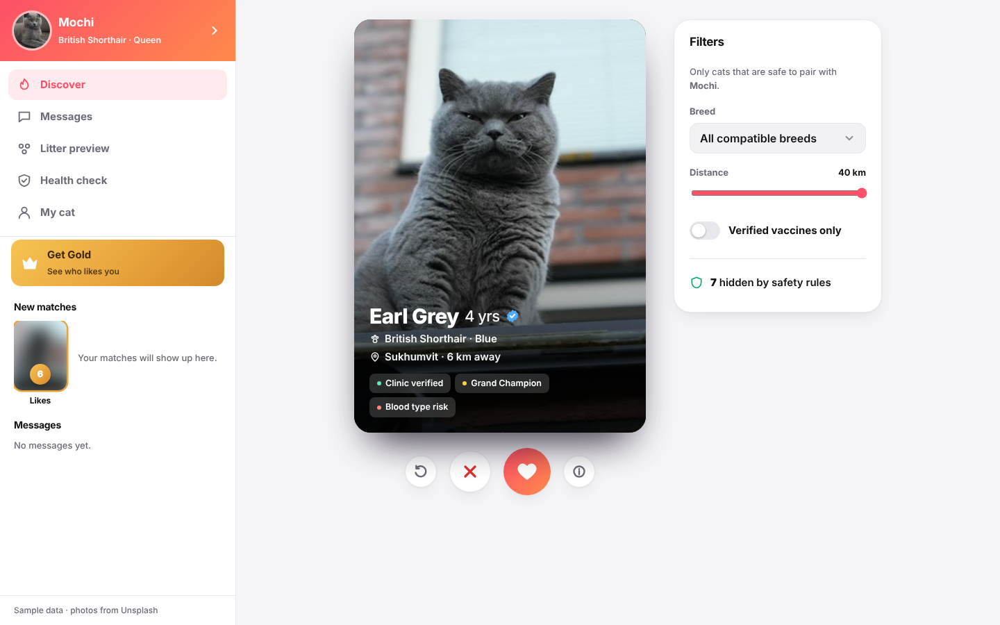
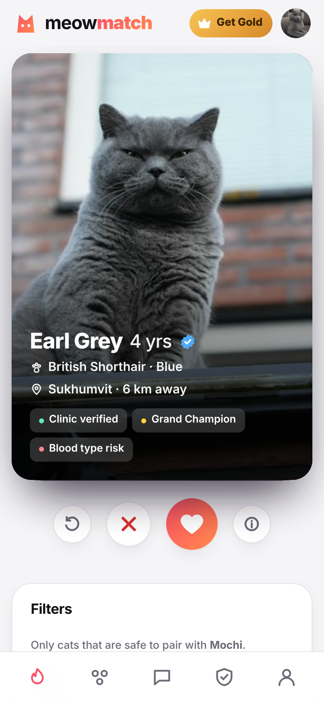
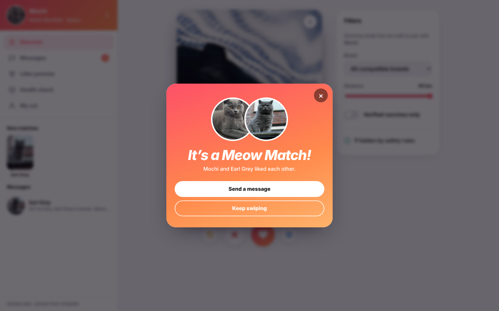
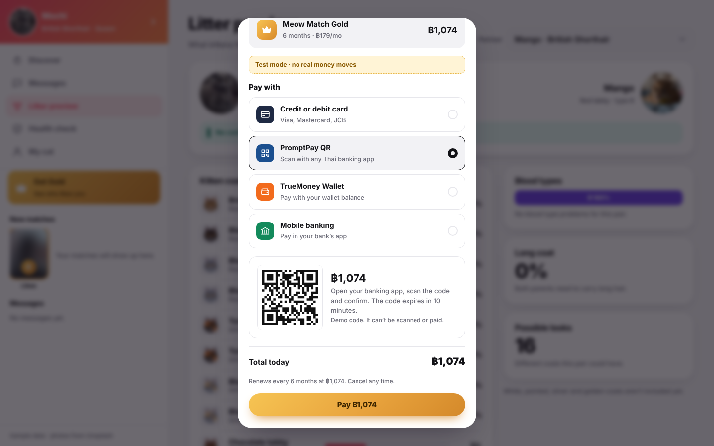
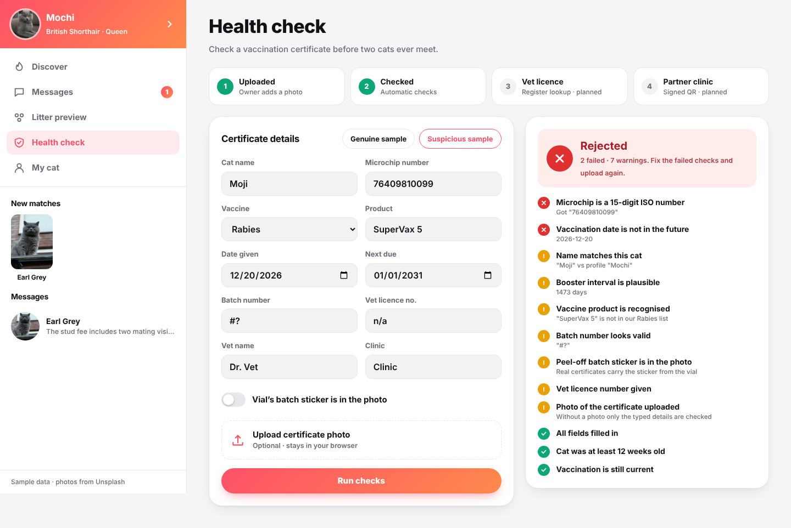
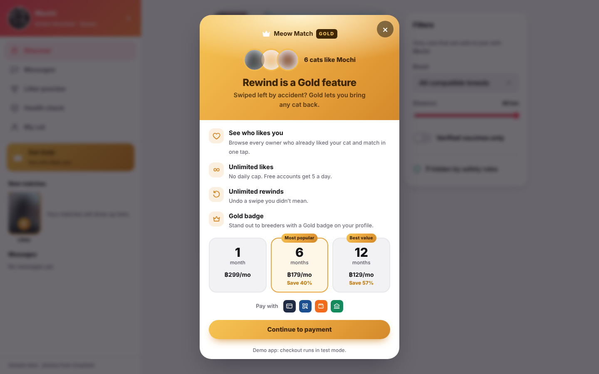
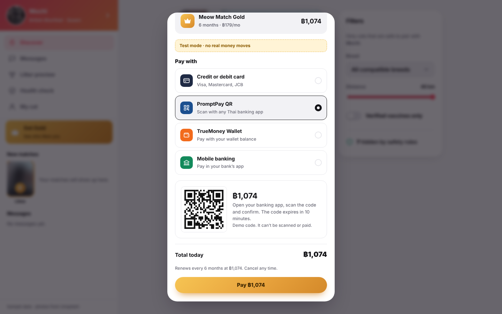
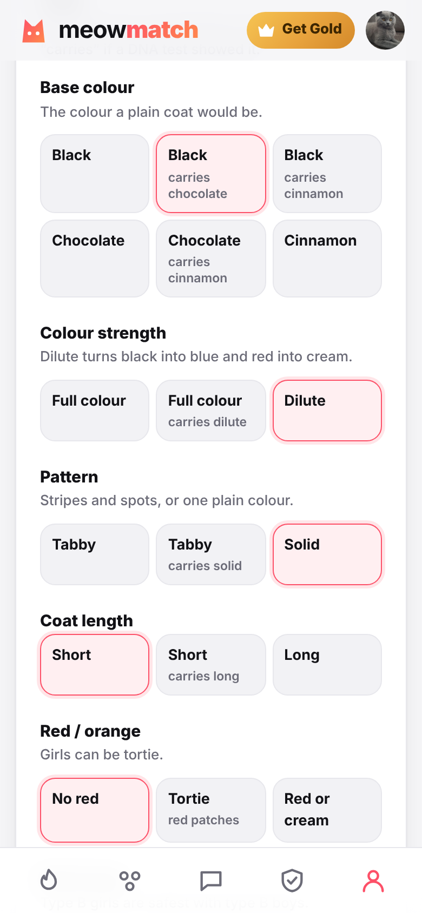

# Meow Match

**Health-first breeding matches for pedigree cats.** Swipe on studs and queens, see what the kittens could look like from both parents' genes, and catch fake vaccination certificates before cats ever meet.

**Live demo:** https://bhonekha.github.io/Meow-Match/



<p align="center"> </p>

> All cats, owners and catteries in the demo are invented sample data.

## Why I built this

Breeders in Thailand mostly find stud cats through Facebook groups and word of mouth. There's no easy way to check health records, and some pairings are risky in ways owners don't always know about: blood-type mismatches that kill newborn kittens, Fold × Fold pairings that cause bone disease, or cats that are simply too young. Meow Match puts those checks *in front of* the swipe, so unsafe matches never show up.

## Features

| | |
|---|---|
| **Swipe deck** | Drag, buttons, or arrow keys. Tap a card for the full profile. Like or pass. A mutual like opens a match and a chat. Free to use: no stud fees or prices on profiles. |
| **Meow Match Gold** | A Tinder Gold-style upgrade: see who already likes your cat (blurred until you upgrade), unlimited likes (free accounts get 5 a day), rewind, and a Gold badge. Paywall with 1/6/12-month plans and a checkout with four Thai payment methods: card, PromptPay QR, TrueMoney Wallet and mobile banking. **Test mode only:** the card form is pre-filled with a test card and can't be typed into, the QR is a fake pattern, and no money moves. |
| **Breeding guardrails** | A rules engine hides unsafe pairings and explains why: under 12 months, no FeLV/FIV test, Fold × Fold, unaccepted outcrosses, too many litters this year. |
| **Litter preview** | A Mendelian genetics model (B/b/bl, D/d, A/a, L/l, X-linked O) predicts kitten coats with ♂/♀ split. Every kitten portrait is drawn from its genotype. |
| **Blood-type risk** | Flags type-B queen × type-A tom pairings and calculates what share of kittens are at risk of neonatal isoerythrolysis. |
| **Certificate check** | Level-1 verification: microchip match, date sanity vs. the cat's age, booster intervals, known vaccine products, batch format, and **EXIF tamper detection** (a photo saved by Photoshop/Canva gets rejected). |
| **Your cat's profile** | Upload a photo (resized in the browser with canvas), edit breed and sex, and set the coat with plain-language choices ("Black, carries chocolate") instead of gene codes. The deck and litter predictions update live. |
| **Real app UX** | Tinder-style sidebar on desktop, tab bar on phones, light and dark mode, keyboard shortcuts, undo. |




<p align="center">  </p>

## Tech

- **Vanilla JavaScript (ES modules), HTML and CSS.** No framework and no build step. It loads straight from GitHub Pages.
- **Pure logic modules** (`genetics.js`, `rules.js`, `certificate.js`) with no DOM access, so the same code runs in the browser and in Node tests.
- **Unit tests** with Node's built-in test runner: 30 tests, zero dependencies.
- **CI:** GitHub Actions runs the tests on every push.
- **Hand-rolled EXIF parser** that reads the JPEG APP1 segment and TIFF IFD0 to get `Software` and `DateTime`.
- **Generated SVG portraits** for predicted kittens and for profiles without a photo: coat colour, tortie patches, tabby stripes, long-hair ruff and folded ears all come from the phenotype.
- State lives in `localStorage` (wrapped in try/catch, so the app still works without it).

```
js/
  genetics.js     Punnett squares, X-linked orange, phenotype naming, litter prediction
  rules.js        Breeding guardrails (blocks vs warnings)
  certificate.js  Certificate consistency checks + EXIF reader
  catArt.js       SVG cat portraits from a phenotype
  data.js         Sample cats
  app.js          UI: routing, swipe deck, chat, views
tests/            node:test unit tests
```

## Run it

```bash
git clone https://github.com/BhoneKha/Meow-Match.git
cd Meow-Match
npm start          # serves on http://localhost:8080 (needs Python 3)
npm test           # runs the unit tests (Node 20+)
```

ES modules need to be served over HTTP, so opening `index.html` directly with `file://` won't work.

### Deploy to GitHub Pages

Repo → **Settings → Pages** → Source: *Deploy from a branch* → `main` / root. Done.

## Verification roadmap

1. **Uploaded:** owner adds a photo ✅
2. **Checked:** automatic consistency and tamper checks ✅ *(this repo)*
3. **Vet licence:** match the vet's licence number against the Veterinary Council of Thailand register
4. **Partner clinic:** clinics issue certificates as signed QR codes straight into the app

## Limitations

- The genetics model leaves out white spotting, colourpoint, silver, golden and the rare AB blood type. Sunny (golden), Thor and Mali (silver) show the nearest coat the model knows.
- Certificate checks catch inconsistencies and obvious edits. They can't *prove* a certificate is genuine, which is what Levels 3–4 are for.
- Gold is a mock upgrade. Real billing would go through Stripe on the web, or Apple/Google in-app purchases in a store app, with entitlements checked on a server.
- Matching, chat replies and data are simulated in the browser. A real version needs a backend (e.g. Supabase) for accounts, storage and realtime chat.

## Next steps

- [ ] Real OCR for certificate photos (Tesseract.js)
- [ ] Supabase backend: auth, photo storage, realtime chat
- [ ] Map view of nearby studs
- [ ] PWA install and offline support

## Photo credits

Cat photos are from [Unsplash](https://unsplash.com) and are used under the [Unsplash License](https://unsplash.com/license). They have been cropped to 600×750.

| File | Photographer |
|---|---|
| `photos/mochi.jpg` | Thomas Haas |
| `photos/earl.jpg` | Oscar Fickel |
| `photos/pounce.jpg` | Andreea Popa |
| `photos/bruno.jpg` | Olga Bi |
| `photos/mango.jpg` | Mariia Paktovskaia |
| `photos/thor.jpg` | Magali Merzougui |
| `photos/simba.jpg` | Mohammad Karami |
| `photos/kai.jpg` | Paul Hanaoka |
| `photos/smokey.jpg` | Max Ogden |
| `photos/luna.jpg` | Grant Durr |
| `photos/mali.jpg` | Sergey Semin |
| `photos/sunny.jpg` | Sotirios T. Kokkinos |
| `photos/bear.jpg` | Carol Gauthier |
| `photos/hazel.jpg` | Frederic Christian |

The cats' names, owners, pedigrees and health records in the demo are invented.

## How I built it

I came up with the idea and the features: swiping for breeding partners, safety rules, litter preview, the vaccine certificate check and Gold. I built it with Claude (Anthropic's AI assistant) as a coding partner, and I reviewed, tested and changed the code along the way.

## License

Code: MIT. Photos: Unsplash License (see above).
